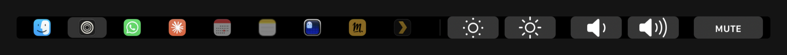

<h1 align="center">Touch My Bar</h1>

<p align="center">
  <b>Your Dock, your volume, your brightness — on the Touch Bar, in every app.</b>
</p>



The Touch Bar spends most of its life showing whatever the app in front
decided you needed. Touch My Bar takes it back and puts something there you'll
actually use: every app in your Dock, and the controls you reach for all day.

It doesn't change when you switch apps. It's just always there.

## Install

```sh
brew tap jdmry/tap
brew trust jdmry/tap
brew install --cask touch-my-bar
xattr -dr com.apple.quarantine "/Applications/Touch My Bar.app"
```

Then turn on the Control Strip in **System Settings → Keyboard → Touch Bar
Settings**, and tap the icon on the right of your bar.

## What you get

**Your Dock, where your thumb already is.** The same apps, in the same order,
running or not. Tap to switch or launch — exactly what clicking the Dock does.
The icon pulses while an app starts up, so you know the tap landed.

**Volume and brightness that never move.** Pinned to the right, in every app,
in the same place every time. Hold to run them up or down. One button says
MUTE or UNMUTE, so you never have to work out which state you're in.

**A tap you can feel.** Optional haptic feedback and a click sound, because a
glass bar gives you nothing back on its own.

**Quit without reaching for the mouse.** Press and hold any app for its
actions — Quit, Hide, New Window.

**Out of your way.** Lives in the menu bar, starts at login, one tap to turn
off when you want the normal bar back.

## Requirements

A Mac with a Touch Bar (MacBook Pro 2016–2022) running macOS 13 or later.
Universal — Intel and Apple silicon.

## Before you install

Those last two commands aren't normal, and you should know what they do.

`brew trust` is Homebrew asking whether you trust this tap. `xattr -dr
com.apple.quarantine` removes the flag macOS uses to block apps Apple hasn't
notarized — this one isn't, so without it macOS simply won't open it.

Both come down to trusting a build Apple hasn't checked. That's a real ask, so
the source is all here and you can build it yourself in two commands instead:

```sh
git clone https://github.com/jdmry/touch-my-bar && cd touch-my-bar
./Scripts/make-app.sh release && open build
```

---

How it works, and the undocumented Apple interfaces it leans on, are written
up in [DEVELOPMENT.md](DEVELOPMENT.md).
